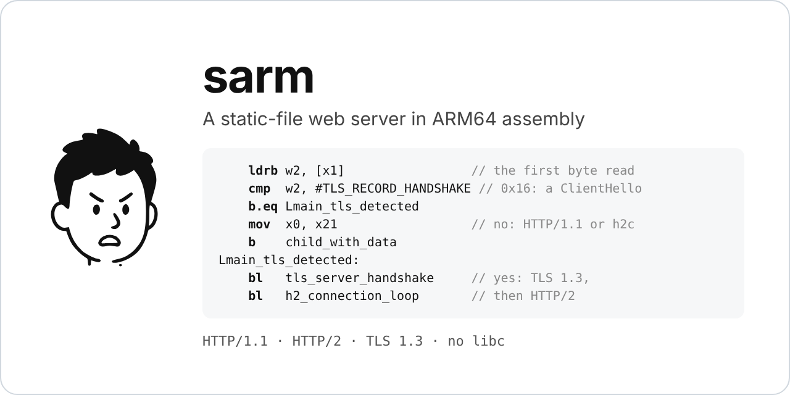

<h1 align="center">sarm</h1>

<p align="center">A static-file web server written by hand in ARM64 assembly: HTTP/1.1, HTTP/2 and TLS 1.3, with no libc.</p>

<p align="center">
  <a href="#quick-start"><b>Quick start</b></a> &nbsp;·&nbsp;
  <a href="#documents">Documents</a> &nbsp;·&nbsp;
  <a href="#how-it-works">How it works</a> &nbsp;·&nbsp;
  <a href="docs/SECURITY.md">Security</a>
</p>

<p align="center">
  
</p>

`sarm` has no libc, no linked libraries and no heap: it talks to the kernel
only through system calls, and serves each connection in its own process. It
speaks **HTTP/1.1**, **HTTP/2** (RFC 9113) and **TLS 1.3** (RFC 8446), with its
own SHA-256, HMAC, HKDF, AES-128-GCM, X25519 and ECDSA P-256. Every asset,
including the error pages and the certificate, is compressed and embedded in
the binary at build time, so nothing is read from disk while serving.

It began from [imtomt/ymawky](https://github.com/imtomt/ymawky) and has been
heavily changed since. It is a fun project written by hand in assembly:
assume it has vulnerabilities.

## Quick start

Needs Apple Silicon (arm64) and the Xcode Command Line Tools
(`xcode-select --install`). Put your site in `www/`, with an `index.html`.

```bash
make                          # embed www/ and the certificate, then assemble and link
make test                     # the full test suite
./sarm 8080                   # serve on 127.0.0.1:8080
./sarm 8080 --workers auto    # one accepting process per logical CPU
curl -k --http2 https://127.0.0.1:8080/
```

## Documents

| Document | What's in it |
| -------- | ------------ |
| [Building and running](docs/usage.md) | Building, running, workers, protocol detection, and everything it does and doesn't do |
| [Configuration](docs/CONFIGURATION.md) | `config.S` options, the MIME table, status codes and certificates |
| [Architecture](docs/ARCHITECTURE.md) | How the server is put together: modules, seams and the request lifecycle |
| [Security](docs/SECURITY.md) | The threat model, the attack surface, and what the security testing found |
| [History](docs/HISTORY.md) | What was changed, what it measured, and what was learned doing it |
| [Multicore baseline](docs/MULTICORE-BASELINE.md) | The throughput work in order, and the noise band around each measurement |
| [Scripts](docs/SCRIPTS.md) | The tooling: tests, profilers, benchmarks, analysers and the optimisation harness |

## How it works

`make` turns everything under `www/` into `src/embedded.S` and the certificate
into `src/tls/cert_data.S`, then assembles every `.S` file and links them into
one binary. At run time the server accepts a connection, forks, and
reads the first bytes: a TLS handshake record (`0x16`) means a TLS 1.3
handshake followed by HTTP/2, the `PRI *` preface means cleartext HTTP/2, and
anything else is HTTP/1.1. Each request path must exactly match an embedded
entry, and text-like assets go out already gzipped, with `ETag`s worked out
at build time. [Architecture](docs/ARCHITECTURE.md) has the details.

Licensed GPL-3.0 ([docs/COPYING](docs/COPYING)).

---

<p align="center"><sub>Part of <a href="https://daleobrien.github.io/#servers">Servers &amp; Systems</a> &nbsp;·&nbsp; more at <a href="https://daleobrien.github.io">daleobrien.github.io</a></sub></p>
